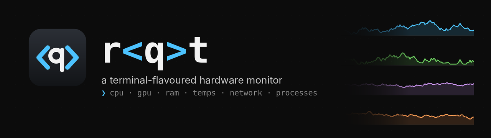

<p align="center">
  
</p>

<p align="center">
  
  
  
  
</p>

# Welcome to r&lt;q&gt;t

**r&lt;q&gt;t** (say it "root", or don't) is a desktop hardware monitor that looks
like it belongs next to your terminal. It shows CPU, GPU, memory,
temperatures, network and disk in real time, keeps a history you can scroll
back through, warns you when something runs hot, and can float a small
overlay on top of whatever you're doing.

<!--
  Screenshot: run `python run.py --screenshot assets/screenshot.png`
  once, commit the file, then delete this comment and the arrows around the line below.
  
-->

## Contents

- [Features](#features)
- [Installing and running](#installing-and-running)
  - [Download (Windows)](#download-windows)
  - [Run from source](#run-from-source)
- [Using r&lt;q&gt;t](#using-rqt)
- [Sensors on each platform](#sensors-on-each-platform)
- [Building your own exe](#building-your-own-exe)
- [Where your data lives](#where-your-data-lives)
- [Project layout](#project-layout)
- [Contributing](#contributing)
- [License](#license)

## Features

- **Live dashboard.** CPU (total, busiest core and every thread), GPU load and VRAM, memory and swap, temperatures, network and disk throughput, each with its own rolling chart
- **Processes.** Sortable and filterable list, with end task, force kill, open file location and copy PID
- **Sensors.** Every temperature, fan, clock and drive the machine exposes, in one tree
- **History.** Every sample goes into a local SQLite file. Browse 15 minutes to 30 days, hover for exact values, export to CSV
- **Alerts.** Rules like *CPU temperature > 90 °C for 10 s*, shown as tray notifications. Each rule re-arms when the value drops back and has a cooldown, so it never spams you
- **Overlay.** Small always-on-top readout with click-through, which you can drag anywhere
- **Benchmark.** SHA-256, zlib, memory copy and disk read/write, each compared against your previous run, plus a stress test for watching clocks and thermals
- **Behaves like an app.** Lives in the tray, starts with Windows if you want, runs only one copy at a time, and can be installed as a real `rqt.exe`

Keyboard: <kbd>Ctrl</kbd>+<kbd>1</kbd>…<kbd>7</kbd> jumps to a tab, and <kbd>Ctrl</kbd>+<kbd>Tab</kbd> cycles through them.

## Installing and running

### Download (Windows)

Grab `rqt-windows-x64.zip` from the [latest release](../../releases/latest),
unzip it anywhere and run `rqt.exe`. Nothing else needs installing.

### Run from source

You need [Python 3.10 or newer](https://www.python.org/downloads/). On
Windows, tick *Add python.exe to PATH* in the installer.

```bash
git clone https://github.com/rqtt/rqt.git
cd rqt
python run.py
```

The first run installs its dependencies (PySide6, pyqtgraph, psutil, numpy),
which takes a minute. If you'd rather do that yourself:

```bash
pip install -r requirements.txt
```

> [!TIP]
> In VS Code, open the folder (**File → Open Folder**), open `run.py` and
> press ▶. On Windows the app detaches from VS Code, so you can close the
> editor and it keeps running in the tray.

`python -m rqt` works too, and `pip install .` gives you an `rqt` command.

| Flag | What it does |
|---|---|
| `--minimized` | start hidden in the tray |
| `--screenshot FILE.png` | open, wait a few seconds, save a screenshot, quit |
| `--attached` | stay attached to the terminal instead of detaching (Windows) |
| `-v`, `--verbose` | also log to the console |

## Using r&lt;q&gt;t

| Tab | |
|---|---|
| **dashboard** | the six live tiles. A dashed line means the secondary series (busiest core, VRAM, swap) |
| **processes** | sort by any column, type to filter, right-click for actions. It's only polled while this tab is open |
| **sensors** | everything the OS reports, grouped |
| **history** | pick a range at the top, scroll to zoom, hover for values. Lines break where the app wasn't running |
| **alerts** | add, edit and remove rules. Recent alerts are listed below the rules |
| **benchmark** | close heavy apps first. Changes under ±3 % are noise |
| **settings** | update rate, units, history retention, tray behaviour, overlay, Windows integration |

Closing the window sends r&lt;q&gt;t to the tray. Right-click the tray icon to
quit or to toggle the overlay.

## Sensors on each platform

| | CPU / RAM / disk / net / processes | Temperatures & fans | GPU |
|---|---|---|---|
| **Windows** | ✅ | via [LibreHardwareMonitor](https://github.com/LibreHardwareMonitor/LibreHardwareMonitor) | NVIDIA built in, others via LibreHardwareMonitor |
| **Linux** | ✅ | ✅ lm-sensors / hwmon | NVIDIA (NVML), AMD (amdgpu) |
| **macOS** | ✅ | ❌ | ❌ |

> [!NOTE]
> Windows has no driver-free way to read CPU temperature. Run
> LibreHardwareMonitor **as administrator** and leave it open in the
> background, and r&lt;q&gt;t picks up all of its sensors automatically. On
> Linux, if no temperatures show up, run `sudo sensors-detect` once.

## Building your own exe

Two ways:

- **From the app:** go to **settings → windows → Install as app**. This
  builds `rqt.exe` into `%LOCALAPPDATA%\rqt\app` and adds desktop and Start
  menu shortcuts. Task Manager then lists it as *r&lt;q&gt;t* rather than *Python*.
- **From a terminal:**
  ```bash
  pip install pyinstaller
  python build.py          # -> dist/rqt/rqt.exe
  ```

Pushing a tag like `v0.6.0` makes the
[release workflow](.github/workflows/release.yml) build the Windows zip and
attach it to a GitHub release.

## Where your data lives

| | |
|---|---|
| Windows | `%APPDATA%\rqt` |
| Linux | `~/.config/rqt` |
| macOS | `~/Library/Application Support/rqt` |

That folder holds `settings.json`, `history.db` (about 6 MB per day at the
default 1 s rate, trimmed to the retention you choose) and `rqt.log`.
Nothing is ever sent anywhere.

## Project layout

```
run.py              start here: installs dependencies on first run, then launches
build.py            PyInstaller build for a standalone exe
rqt/
  sensors.py        CPU / memory / disk / network / temperature sampling
  gpu.py            NVIDIA (NVML), AMD (sysfs) and LibreHardwareMonitor backends
  lhm.py            Windows WMI bridge to LibreHardwareMonitor
  procs.py          process table
  history.py        SQLite logging, range queries, CSV export
  alerts.py         alert rules and the engine that evaluates them
  bench.py          benchmark and stress test
  worker.py         background sampling thread
  winapp.py         Windows integration: taskbar identity, autostart, exe build
  config.py         settings.json
  ui/               everything Qt: window, tabs, charts, overlay, theme
tests/              unit tests for everything that doesn't need a display
assets/             icon and README art
```

Everything outside `rqt/ui/` is plain Python with no Qt import, so you can
experiment with it from a REPL:

```python
>>> from rqt.sensors import Sampler
>>> s = Sampler(); import time; time.sleep(1); s.sample().cpu
12.5
```

## Contributing

Bug reports, ideas and pull requests are welcome. See
[CONTRIBUTING.md](CONTRIBUTING.md) for the dev setup. In short:

```bash
python -m unittest discover -s tests -v
```

## License

[MIT](LICENSE)
